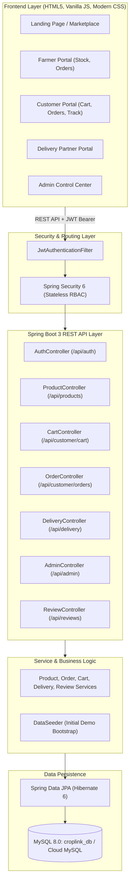

# 🌿 CropLink — Farm-Door Delivery Platform

> **Project Name:** CropLink  
> **Project Title:** Farm-Door Delivery Platform (Farm2Door)  
> **Domain:** Smart Agricultural Direct-to-Consumer (D2C) Marketplace & Order Fulfillment  
> **Tech Stack:** Java 25 LTS, Spring Boot 3, Spring Security, JWT, Spring Data JPA, MySQL, Vanilla HTML5/CSS3/JavaScript  
> **Deployment Ready:** Local Development & Render Cloud Platform (Docker / Web Service)

---


---

## 📌 1. Project Overview

**CropLink** is a smart digital agricultural marketplace that eliminates predatory middlemen by connecting farmers directly with urban and suburban consumers. 

Through **CropLink: Farm-Door Delivery Platform**, rural farmers can list their harvested crops, set honest prices, track inventory, and manage incoming orders. Consumers can browse farm-fresh produce with complete harvest traceability (freshness status, ripeness level, quality grade, organic certification), order via flexible delivery methods (Farm Pickup, Farmer Delivery, Delivery Partner), and track real-time fulfillment from farm to their doorstep.

---

## 🎯 2. System Architecture & Flow



---

## 👥 3. User Roles & Capabilities

| Role | Responsibilities & Capabilities |
| :--- | :--- |
| **🌾 FARMER** | • Register and configure farm details (location, village, state, pincode)<br>• List fresh crops with multi-image upload, price, unit, freshness, ripeness & organic status<br>• Real-time stock management and order processing (Accept, Reject, Pack)<br>• Revenue analytics and sales dashboard |
| **🛒 CUSTOMER** | • Search, filter by agricultural categories, and sort produce by price or rating<br>• Add items to live cart with instant subtotal calculations<br>• Checkout with flexible delivery options (Farm Pickup, Farmer Delivery, Delivery Partner)<br>• Simulated payment methods (COD, UPI, Card, Net Banking)<br>• Visual step-by-step order tracking timeline and post-delivery product reviews |
| **🚚 DELIVERY PARTNER** | • View orders packed and ready for dispatch<br>• Accept unassigned deliveries in service areas<br>• Update real-time transit status (`OUT_FOR_DELIVERY` ➔ `DELIVERED`) |
| **⚙️ ADMIN** | • Global platform analytics (total revenue, active products, pending orders, user counts)<br>• User lifecycle management (Activate, Block, Review profiles)<br>• Product quality approvals and status overrides<br>• Dynamic category management (Add, Edit, Activate, Deactivate) |

---

## 🌽 4. Agricultural Attributes & Quality Parameters

Every product listed on **CropLink** tracks specialized agronomic parameters:

- **Categories (9 Standard):** Vegetables, Fruits, Grains, Spices, Pulses, Dairy Products, Flowers, Seeds and Plants, Other Products.
- **Supported Units:** `kg`, `g`, `litre`, `piece`, `dozen`, `packet`, `bundle`.
- **Quality Grades:** `Premium`, `Standard`, `Economy`.
- **Ripeness Levels:** `Raw`, `Semi-Ripe`, `Ripe`, `Fully Ripe`.
- **Freshness Indicators:** `Harvested Today`, `1 Day Old`, `2 Days Old`, `More Than 2 Days Old`.
- **Cultivation Type:** `100% Certified Organic`, `Pesticide-Free`, `Conventional`.
- **Delivery Options:** `Farm Pickup`, `Farmer Delivery`, `Delivery Partner`.

---

## 🗄️ 5. Database Schema (15 Relational Tables)

The database schema is fully managed via Spring Data JPA and Hibernate (`ddl-auto=update`):

1. **`users`**: Base credentials, email (unique), BCrypt password, role, account status.
2. **`farmer_profiles`**: Farm name, address, village, district, state, pincode, GPS coordinates.
3. **`customer_profiles`**: Delivery address, district, state, pincode, GPS coordinates.
4. **`delivery_partner_profiles`**: Vehicle type, service coverage areas, active status.
5. **`categories`**: Product classifications and administrative status.
6. **`products`**: Comprehensive crop attributes, price, stock, ratings, review counters.
7. **`product_images`**: Multi-image URLs with primary thumbnail indicator.
8. **`carts`**: Active customer shopping carts.
9. **`cart_items`**: Line items with foreign keys to products and quantities.
10. **`orders`**: Order amounts, delivery fees, payment/fulfillment status, dispatch logs.
11. **`order_items`**: Snapshot of product details and price at time of order creation.
12. **`payments`**: Simulated transaction logs, payment method, settlement reference.
13. **`reviews`**: Verified customer star ratings (1–5) and feedback comments.
14. **`notifications`**: System alerts for order placement, dispatch, and delivery updates.
15. **`audit_logs`**: Platform activity logs for administrative traceability.

*(A complete reference script is available in [`schema.sql`](schema.sql)).*

---

## 🔑 6. Pre-Seeded Demo Credentials

The platform includes an automated `DataSeeder` that seeds initial categories, active products, and testing accounts upon initial boot:

| Role | Email | Password | Access Portal |
| :--- | :--- | :--- | :--- |
| **Admin** | `admin@croplink.com` | `Admin@123` | [`/pages/admin-dashboard.html`](/pages/admin-dashboard.html) |
| **Farmer** | `farmer@croplink.com` | `Farmer@123` | [`/pages/farmer-dashboard.html`](/pages/farmer-dashboard.html) |
| **Customer** | `customer@croplink.com` | `Customer@123` | [`/pages/products.html`](/pages/products.html) |
| **Delivery Partner** | `delivery@croplink.com` | `Delivery@123` | [`/pages/delivery-dashboard.html`](/pages/delivery-dashboard.html) |

---

## 💻 7. Local Setup & Execution Guide

### Prerequisites
- **JDK 25 LTS** installed and selected in `JAVA_HOME`/`PATH` (`java -version`)
- **MySQL 8.0+** running locally
- Git installed

### Step 1: Create Local MySQL Database
Open your MySQL client (Command Line or MySQL Workbench) and execute:
```sql
CREATE DATABASE IF NOT EXISTS croplink_db CHARACTER SET utf8mb4 COLLATE utf8mb4_unicode_ci;
CREATE USER IF NOT EXISTS 'croplink'@'localhost' IDENTIFIED BY 'CropLink@123';
GRANT ALL PRIVILEGES ON croplink_db.* TO 'croplink'@'localhost';
FLUSH PRIVILEGES;
```

### Step 2: Run the Application

#### Option A: Using the 1-Click Batch Script (Windows)
Double-click `run.bat` or run:
```cmd
run.bat
```

#### Option B: Using Maven Wrapper
```bash
# Windows
./mvnw.cmd spring-boot:run

# Linux / macOS
./mvnw spring-boot:run
```

#### Option C: Running the Compiled Fat JAR
```bash
java -jar target/croplink-1.0.0.jar
```

Open your browser and navigate to: **[http://localhost:8080](http://localhost:8080)**

---

## 📤 8. Step-by-Step GitHub Upload Guide

Follow these steps to upload the project from your computer / VS Code to a new GitHub repository:

### Step 1: Initialize Git in the Project Root
Open PowerShell or Terminal inside the `Croplink` folder:
```powershell
cd "C:\Users\basil\OneDrive\Desktop\Projects\College\Croplink"

# Initialize git repository
git init
```

### Step 2: Stage and Commit the Files
```powershell
# Add all files (the provided .gitignore safely ignores target/ and temporary files)
git add .

# Create initial commit
git commit -m "Initial commit: CropLink - Farm-Door Delivery Platform"
```

### Step 3: Create a New Repository on GitHub
1. Go to [https://github.com/new](https://github.com/new)
2. Enter repository name: **`CropLink`** (or `croplink-farm2door`)
3. Set visibility to **Public** (or Private)
4. **Do NOT** initialize with README, `.gitignore`, or license (we already created them)
5. Click **Create repository**

### Step 4: Link and Push to GitHub
Copy the repository URL from GitHub and run:
```powershell
# Set default branch to main
git branch -M main

# Link remote origin (replace YOUR_USERNAME and YOUR_REPO)
git remote add origin https://github.com/YOUR_USERNAME/CropLink.git

# Push to GitHub
git push -u origin main
```

---

## 🚀 9. Step-by-Step Railway Cloud Deployment (Recommended — 1-Click MySQL + Zero Cold Starts)

Railway is the most efficient and straightforward cloud platform for running **CropLink** because **both the Spring Boot Web Service and the MySQL Database run inside the same project with automatic internal linking**.

```mermaid
flowchart LR
    GitHub["GitHub (CropLink Repo)"] -->|Auto Deploy| RailwayService["Railway Web Service (Spring Boot 3)"]
    RailwayService <-->|Internal Network (Port 3306)| RailwayMySQL[(Railway Managed MySQL)]
    User((Users / Evaluators)) -->|HTTPS URL| RailwayService
```

### Why Railway is Best for CropLink:
1. **1-Click MySQL:** No need to register for an external cloud database.
2. **Zero Manual DB Configuration:** CropLink's `application.properties` automatically reads `${MYSQLHOST}`, `${MYSQLPORT}`, `${MYSQLDATABASE}`, `${MYSQLUSER}`, and `${MYSQLPASSWORD}` injected by Railway!
3. **No Cold Starts:** The app responds instantly without the 50-second sleep delay found on free container tiers.
4. **Automatic SSL / HTTPS Domain:** Railway provisions a free public domain (e.g. `croplink-production.up.railway.app`).

---

### Step 1: Provision MySQL on Railway
1. Go to **[https://railway.app](https://railway.app)** and log in with your **GitHub account**.
2. Click **+ New Project**.
3. Select **Provision MySQL**.
4. Railway will create a dedicated MySQL 8.0 database container in ~10 seconds.

---

### Step 2: Deploy the CropLink Application
1. In the same Railway project canvas, click **+ Create** (or **+ New**).
2. Select **GitHub Repo**.
3. Choose your **`CropLink`** repository.
4. Railway will automatically detect the [`railway.json`](railway.json) / [`Dockerfile`](Dockerfile) and begin building.

---

### Step 3: Link MySQL to CropLink
1. Click on your **CropLink service** on the Railway canvas.
2. Go to the **Variables** tab.
3. Click **Add Variable Reference** (or **New Variable**):
   - Click **Reference Variable** ➔ Select your **MySQL** service ➔ Select `MYSQLHOST`.
   - Repeat to reference: `MYSQLPORT`, `MYSQLDATABASE`, `MYSQLUSER`, `MYSQLPASSWORD`.
   *(Or simply add a single variable `SPRING_DATASOURCE_URL` referencing `${{MySQL.DATABASE_URL}}`)*.
4. Add a unique random `JWT_SECRET` of at least 32 bytes. Do not reuse the example secret from an older deployment; keep the value in the provider's secret manager.

---

### Step 4: Generate Your Public Domain
1. In your **CropLink** service, go to the **Settings** tab.
2. Scroll to the **Networking** section.
3. Click **Generate Domain** (or set a custom domain).
4. Railway will assign an instant public HTTPS link (e.g. `https://croplink-production.up.railway.app`).

### Step 5: Test and Enjoy
Click your generated Railway domain!  
Spring Boot will start, Hibernate will create all 15 tables automatically, `DataSeeder` will populate the demo catalog, and your direct farm-to-door delivery platform is live on the internet!

---

## ☁️ 10. Step-by-Step Render Cloud Deployment Guide (Alternative)

Render allows you to host the Spring Boot Web Application for free using the included `Dockerfile` and `render.yaml`.

### Step 1: Get a Free Cloud MySQL Database
Because Render free tier does not include managed MySQL directly, you can use any free managed MySQL database provider:

#### Option A: Aiven (Recommended - Free Tier)
1. Sign up at [https://aiven.io](https://aiven.io)
2. Create a free **MySQL** database service.
3. Note your connection details:
   - **Host** (e.g. `mysql-xxxx.aivencloud.com`)
   - **Port** (e.g. `12345`)
   - **User** (e.g. `avnadmin`)
   - **Password**
   - **Database Name** (e.g. `defaultdb` or create `croplink_db`)

#### Option B: Clever Cloud or TiDB Cloud (Free MySQL)
1. Sign up at [https://www.clever-cloud.com](https://clever-cloud.com) or [https://tidbcloud.com](https://tidbcloud.com)
2. Create an Add-on MySQL database and copy the JDBC URL, username, and password.

---

### Step 2: Deploy Web Service on Render

1. Log in to your [Render Dashboard](https://dashboard.render.com).
2. Click **New +** ➔ Select **Web Service**.
3. Connect your GitHub account and select your **`CropLink`** repository.
4. Fill in the deployment settings:
   - **Name:** `croplink`
   - **Region:** Singapore / Oregon / Frankfurt (pick closest to your database)
   - **Branch:** `main`
   - **Runtime:** **Docker** *(Render detects the `Dockerfile` automatically)*
   - **Instance Type:** **Free**

---

### Step 3: Configure Environment Variables on Render
Scroll down to the **Environment Variables** section on Render and add:

| Key | Value | Description |
| :--- | :--- | :--- |
| `PORT` | `8080` | Render port binding |
| `DB_HOST` | `your-db-host.com` | Hostname from Aiven / Clever Cloud |
| `DB_PORT` | `3306` (or provider port) | MySQL port |
| `DB_NAME` | `croplink_db` (or defaultdb) | Database name |
| `DB_USERNAME` | `your-db-user` | MySQL username |
| `DB_PASSWORD` | `your-db-password` | MySQL password |
| `JWT_SECRET` | A unique random value of at least 32 bytes | Secret for signing tokens; generate and store it securely |
| `CORS_ALLOWED_ORIGINS` | `https://your-frontend.example.com` | Comma-separated exact origins when hosting the frontend separately; same-origin deployments need no override |
| `UPLOAD_DIR` | `uploads/products` | Local directory for uploaded product images; use persistent storage in production |

> **Note:** Alternatively, if your cloud database provider provides a single full JDBC URL, you can simply set:  
> `DATABASE_URL` = `jdbc:mysql://<user>:<password>@<host>:<port>/<dbname>?useSSL=true`

---

### Step 4: Deploy and Verify
1. Click **Create Web Service**.
2. Render will trigger the multi-stage Docker build:
   - Compiles all 76 Spring Boot source files with Maven.
   - Creates a lightweight, secure production Alpine Linux image.
   - Starts Spring Boot and auto-seeds the initial demo catalog.
3. Once the logs display `Tomcat started on port 8080` and `BUILD SUCCESS`, your live web application will be accessible at:  
   **`https://croplink.onrender.com`** (or your assigned `.onrender.com` domain).

---

## 📡 10. Core REST API Endpoints

### 🔐 Authentication & Accounts
- `POST /api/auth/register` — Register as Farmer, Customer, or Delivery Partner
- `POST /api/auth/login` — Authenticate and receive JWT Bearer token
- `GET /api/user/profile` — Fetch current authenticated user profile
- `PUT /api/user/profile` — Update personal contact details

### 🌾 Products & Catalog
- `GET /api/products/public` — Browse active crops (supports category filter, text search, sorting, and pagination)
- `GET /api/products/public/{id}` — Detailed crop specifications, freshness & ratings
- `GET /api/categories/public` — List active agricultural categories
- `GET /api/farmer/products` — Retrieve all crops listed by authenticated farmer
- `POST /api/farmer/products` — Create new crop listing with multi-image multipart upload
- `PUT /api/farmer/products/{id}` — Edit price, stock, freshness, or details
- `DELETE /api/farmer/products/{id}` — Remove crop listing

### 🛒 Cart & Order Management
- `GET /api/customer/cart` — View current customer basket
- `POST /api/customer/cart` — Add product to basket
- `PUT /api/customer/cart/{itemId}` — Modify quantity
- `DELETE /api/customer/cart/{itemId}` — Remove item
- `POST /api/customer/orders` — Place order and deduct stock atomically
- `GET /api/customer/orders` — Customer order history
- `GET /api/customer/orders/{id}` — Single order status and line items
- `GET /api/farmer/orders` — Incoming orders for farmer review
- `PATCH /api/farmer/orders/{id}/status` — Advance status (`ACCEPTED`, `PACKED`, `REJECTED`)

### 🚚 Delivery & Partner Logistics
- `GET /api/delivery/available` — Available packed orders awaiting pickup
- `GET /api/delivery/orders` — Active deliveries claimed by partner
- `POST /api/delivery/orders/{orderId}/accept` — Claim delivery task
- `PATCH /api/delivery/orders/{orderId}/status` — Mark `OUT_FOR_DELIVERY` or `DELIVERED`

### ⭐ Reviews & Notifications
- `GET /api/products/public/{productId}/reviews` — View verified customer reviews
- `POST /api/customer/reviews` — Submit 1–5 star rating & feedback
- `GET /api/notifications` — Real-time user alert feed
- `PUT /api/notifications/read-all` — Mark alerts as read

### 🛠️ Platform Administration
- `GET /api/admin/dashboard` — Platform financial and volume metrics
- `GET /api/admin/users` — Paginated list of registered users
- `PATCH /api/admin/users/{id}/status` — Moderate user access (`ACTIVE`, `BLOCKED`)
- `GET /api/admin/products` — Product catalog review
- `PATCH /api/admin/products/{id}/status` — Approve or reject crop listings
- `POST /api/admin/categories` — Create agricultural categories

---

## 👨‍💻 College Project Submission Details

- **Application Name:** CropLink
- **Project Title:** Farm-Door Delivery Platform
- **Architecture:** Client-Server Multi-Tiered Architecture (N-Tier)
- **Design Pattern:** Repository-Service-Controller (IoC / Dependency Injection)
- **Security Standard:** Stateless JWT (JSON Web Tokens) with Role-Based Access Control (RBAC)

---

*Developed with ❤️ for Farmers and Direct Doorstep Delivery.*
# CropLink

